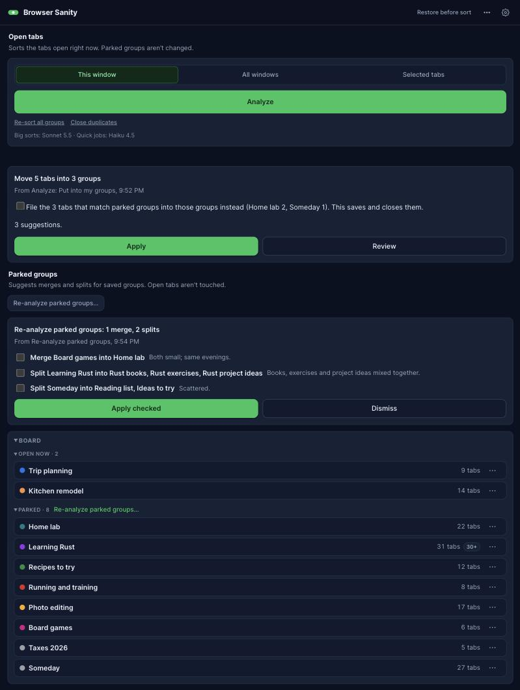
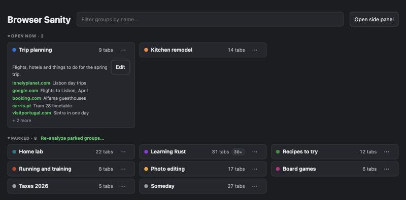

# Browser Sanity

Browser Sanity is a Chrome and Edge extension for people who keep a lot of tabs. It treats tab groups as bookmarks you organize by what you need them for, not by which site they came from. Click Analyze and an AI model you choose files your loose tabs into your groups, or suggests new ones. Nothing moves until you approve it, and one click puts it back. Groups you don't need right now can be parked: saved, closed, and reopened later with one click.

Browser Sanity is a fork of [Browser Organizer](https://github.com/LUSKTECH/browser-organizer) by Lusk Technologies, used and shared under the [MIT License](LICENSE). Thank you to Lusk Technologies for the original extension, its local helper and its AI backends, which Browser Sanity builds on.

| The side panel | The new-tab board |
|:---:|:---:|
|  |  |

## What it does

- **Analyze your open tabs.** It counts loose tabs and duplicates first, then you choose **Put into my groups** or **Suggest new groups**. Review the result, apply it, and undo it if you change your mind. **Re-sort all groups** and **Close duplicates** are there for the occasional big cleanup.
- **Park groups.** A parked group is saved and closed. It stays on the board, and **Open** brings its tabs back. When you sort, tabs for an open group join it and stay open; tabs for a parked group are put away in it, so a parked group stays out of sight (uncheck one box to keep them open instead). A live group and a parked group with the same name are one group: its parked tabs stay saved until you add them back or park it.
- **Keep groups useful.** Each group can carry a one-line description. Groups past 30 tabs are flagged, **Split** breaks one into need-based sub-groups, and **Re-analyze parked groups** suggests merges and splits for you to check off.
- **See everything on one board,** on the new-tab page and in the side panel. Click a card for its description and its top five sites.
- **Know what did what.** Every suggestion says what made it and when.
- **Bring your own AI.** Use a Claude subscription through Claude Code, another AI command-line tool, a local model, or any OpenAI-style service (OpenAI, OpenRouter, Poe and others). Big sorts and quick jobs can use different models.
- **Let your own AI agent help.** The helper keeps a plain-file index of every group and its tabs that any agent can read, and an agent can leave suggestions in `proposals.json` for you to approve.

## Install

You need Chrome 116 or later (or a recent Edge), [Node.js 20+](https://nodejs.org), and one AI backend (see below).

1. Get the code: `git clone https://github.com/Greenysmac/browser-sanity.git`
2. Load the extension: open `chrome://extensions` (or `edge://extensions`), turn on **Developer mode**, click **Load unpacked**, and pick the `extension/` folder.
3. Register the local helper, from the project folder:
   ```
   npm run install-host
   ```
   This copies the helper to `~/.browser-sanity` (or `%LOCALAPPDATA%\BrowserSanity` on Windows) and registers it for Chrome and Edge. The extension's ID is fixed by the key in its manifest, so the helper already knows it.
4. Click the toolbar icon to open the side panel, choose your AI in **Settings** (the gear), and click **Analyze**.

[INSTALL.md](INSTALL.md) has the details and troubleshooting.

## Your groups file (optional)

Write the groups you want, one per line, in `~/.browser-sanity/groups.md`, and Browser Sanity sends them with every request so tabs land where you'd put them:

```
- Home lab: self-hosted apps, home network, Raspberry Pi projects.
- Trip planning: flights, places to stay, things to do.
- Someday: long-term ideas and reading that aren't for right now.

A tab that fits none of these goes in Someday.
```

## Files the helper keeps

All in `~/.browser-sanity`, on your machine only:

- `index.json` and `index.md`: every group, open or parked, with its tabs. Tab titles are copied from web pages, so treat them as untrusted text.
- `index-history/`: the newest 50 copies of the index, made before each change.
- `groups.md`: your groups file, if you write one.
- `proposals.json`: suggestions an AI agent leaves for you to approve, if you use one.

## AI backends

Pick one in **Settings**. The extension hands each request to the local helper, which runs that backend and returns the result.

| Backend | Command | Auth |
|---------|---------|------|
| Claude Code *(default)* | `claude -p --output-format json` | your saved `claude` login (a Claude subscription works) |
| Antigravity | `agy -p "<prompt>" --yes --no-color` | saved `agy` login, or `GEMINI_API_KEY` / `ANTIGRAVITY_API_KEY` |
| Kiro | `kiro-cli chat --no-interactive "<prompt>"` | `KIRO_API_KEY` |
| GitHub Copilot | `copilot -p "<prompt>" -s --no-ask-user` | `COPILOT_GITHUB_TOKEN` / `GH_TOKEN`, or a `gh` login |
| OpenAI Codex | `codex exec --skip-git-repo-check "<prompt>"` | saved ChatGPT login, or `OPENAI_API_KEY` |
| Ollama | `ollama run <model>` | none; fully local |
| OpenAI-style API | `POST <base>/chat/completions` | a key entered in **Settings** (encrypted at rest), or `BROWSER_SANITY_OPENAI_API_KEY` |

The OpenAI-style backend covers OpenAI, OpenRouter, Poe, Groq, Together and local servers like LM Studio; change the base URL in Settings. To point the helper at a command-line tool in an unusual place, set `BROWSER_SANITY_CLI` (Claude), `BROWSER_SANITY_ANTIGRAVITY_CMD`, `BROWSER_SANITY_KIRO_CMD`, `BROWSER_SANITY_COPILOT_CMD`, `BROWSER_SANITY_CODEX_CMD` or `BROWSER_SANITY_OLLAMA_CMD`.

## Privacy

Only tab titles and URLs leave your machine, and only to the AI provider you picked, under your own account. The index, history copies and groups file stay on your machine. There is no Browser Sanity server. See [PRIVACY.md](PRIVACY.md) and [docs/security-model.md](docs/security-model.md).

## Development

- `npm test` runs the unit tests (`node --test`, no browser needed).
- `npm run lint` runs ESLint.
- The Playwright tests in `e2e/` come from the original project and were written for its layout; they haven't been updated for Browser Sanity.

## License and credits

MIT. Copyright (c) 2026 Lusk Technologies, and (c) 2026 Jeff Greenberg for the Browser Sanity changes. See [LICENSE](LICENSE). Browser Sanity started from Browser Organizer 0.1.8; its history is in [CHANGELOG.md](CHANGELOG.md).
